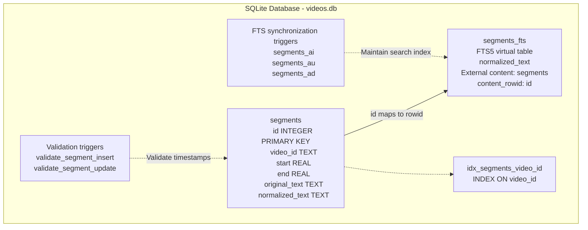
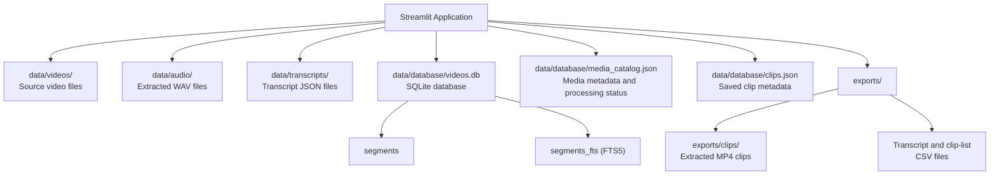

# Arabic Media Archiving, Transcription and Search System

An Arabic-focused application that converts speech in video and standalone audio files into timestamped transcripts, makes transcript content searchable, and allows users to locate relevant moments. Video segments can also be extracted as standalone clips.

**Repository:** [Momen-Abd32/Development-of-an-Arabic-Transcript-Based-Video-Indexing-and-Clip-Search-System](https://github.com/Momen-Abd32/Development-of-an-Arabic-Transcript-Based-Video-Indexing-and-Clip-Search-System)

---

## Table of Contents

- [Project Overview](#project-overview)
- [Features](#features)
- [Technologies](#technologies)
- [System Workflow](#system-workflow)
- [Application Architecture](#application-architecture)
- [Database Schema](#database-schema)
- [Data Storage Architecture](#data-storage-architecture)
- [Project Structure](#project-structure)
- [Requirements](#requirements)
- [Installation](#installation)
- [Running the Application](#running-the-application)
- [Batch Importing a Media Dataset](#batch-importing-a-media-dataset)
- [Running Tests](#running-tests)
- [Evaluation Metrics](#evaluation-metrics)
- [Configuration and Usage Notes](#configuration-and-usage-notes)
- [Known Limitations](#known-limitations)
- [Future Work](#future-work)
- [License](#license)

## Project Overview

Finding a specific moment in a long video or audio recording can be time-consuming, particularly when the content is spoken in Arabic and the user does not know the exact timestamp. This project addresses that problem by turning spoken media content into searchable, timestamped transcript segments.

The application supports individual video and audio uploads, while a batch-import utility can process a local folder of media files. It prepares audio, generates Arabic transcripts, indexes transcript segments, and allows users to search for words or phrases. Video search results can also be exported as separate clips.

The interface supports **Arabic and English**, with Arabic as the default language.

## Features

- **Video upload and preview:** Upload and preview supported video files.
- **Standalone audio upload and playback:** Upload audio recordings without requiring a video container.
- **Audio preparation:** Use FFmpeg to normalize audio from video or standalone audio files to mono 16 kHz WAV for transcription.
- **Batch media import:** Recursively scan a local folder and process supported audio and video files one by one.
- **Media catalog:** Persist each media file's type, original filename, stored path, and processing status.
- **Archive-wide search:** Search transcript segments across all imported media or limit the search to the currently selected file.
- **Duplicate detection:** Identify identical files using SHA-256 and avoid processing duplicate content within the same batch.
- **Transcript reuse:** Reuse existing transcript JSON files and rebuild their search index instead of transcribing the same media again.
- **Arabic speech recognition:** Generate timestamped transcript segments with Faster-Whisper.
- **Transcript review and editing:** Review generated segments, correct their text, and save the updated transcript.
- **Arabic text normalization:** Normalize common Arabic character variations, remove diacritics and tatweel, and standardize whitespace to improve search consistency.
- **Exact full-text search:** Find transcript segments using SQLite FTS5.
- **Fuzzy search:** Find approximate matches using RapidFuzz.
- **Timestamped results:** Display matching transcript text with its position in the source video or audio recording.
- **Clip extraction:** Extract a selected time range from the source video as an MP4 clip.
- **Saved clip management:** Store clip metadata and view saved clips associated with a video.
- **CSV export:** Export transcript segments and saved clip metadata.
- **Transcription evaluation utilities:** Calculate Word Error Rate (WER) and Character Error Rate (CER) against a reference transcript.

### Supported video formats

- MP4
- MKV
- MOV
- AVI
- WEBM

### Supported audio formats

- MP3
- WAV
- M4A
- AAC
- FLAC
- OGG

The Streamlit application upload limit is configured to **2 GB per file**. Actual processing capacity depends on available memory, storage, CPU, and media duration.

## Technologies

| Technology | Role |
|---|---|
| Python 3.12 | Main programming language |
| Streamlit | Web application interface |
| Faster-Whisper | Arabic automatic speech recognition |
| FFmpeg | Audio extraction and video clip processing |
| SQLite | Persistent transcript-segment storage |
| SQLite FTS5 | Full-text transcript search |
| RapidFuzz | Approximate text matching |
| JiWER | WER and CER evaluation |
| Pytest | Automated testing |

## System Workflow

1. The user uploads a supported video file.
2. The application identifies the video using a SHA-256 hash and stores the source file under `data/videos/`.
3. FFmpeg extracts the video's audio and saves it under `data/audio/`.
4. Faster-Whisper transcribes the audio in Arabic and produces timestamped segments.
5. The transcript is saved as JSON under `data/transcripts/`.
6. Arabic text is normalized and transcript segments are indexed in SQLite.
7. The user reviews or edits transcript segments.
8. The user searches the transcript using exact or fuzzy search.
9. Search results show the matching text and its timestamps.
10. The user can extract a selected segment as an MP4 clip and save its metadata.
11. Transcript data and clip metadata can be exported as CSV files.

## Application Architecture

The application separates its main responsibilities into modules under `src/`:

| Module | Responsibility |
|---|---|
| `media` | Prepare normalized audio from video and standalone audio files; batch-import media folders |
| `transcription` | Run speech recognition, validate and manage transcripts, and export transcript data |
| `indexing` | Normalize Arabic text and index transcript segments |
| `search` | Perform exact and fuzzy transcript searches |
| `database` | Create and manage SQLite tables, indexes, and triggers |
| `clips` | Extract video clips, manage clip metadata, and export clip lists |
| `evaluation` | Calculate transcription evaluation metrics |

The Streamlit interface in `app.py` coordinates these modules and presents the workflow to the user.

## Database Schema

The application uses SQLite to store transcript segments and power full-text search. The database is created at:

```text
data/database/videos.db
```

### Main table: `segments`

| Column | Type | Description |
|---|---|---|
| `id` | INTEGER PRIMARY KEY AUTOINCREMENT | Unique segment identifier |
| `video_id` | TEXT | Identifier of the source media file (video or audio) |
| `start` | REAL | Segment start time in seconds |
| `end` | REAL | Segment end time in seconds |
| `original_text` | TEXT | Transcript text |
| `normalized_text` | TEXT | Normalized text used for indexing and search |

### Full-text search: `segments_fts`

The `segments_fts` virtual table uses SQLite FTS5 with an external-content configuration linked to `segments`.

- `normalized_text` is the indexed search content.
- `content='segments'` identifies the source table.
- `content_rowid='id'` maps FTS rows to the primary keys in `segments`.

### Indexes and triggers

- `idx_segments_video_id`: Indexes the source media identifier used to filter transcript segments.
- `validate_segment_insert`: Rejects invalid segment timestamps on insertion.
- `validate_segment_update`: Rejects invalid segment timestamps on update.
- `segments_ai`: Adds inserted segment text to the FTS index.
- `segments_au`: Updates the FTS index when a segment changes.
- `segments_ad`: Removes deleted segment text from the FTS index.

### Database schema diagram



**Schema note:** FTS5 is an external-content search index synchronized with the `segments` table through triggers. The current database schema does not define separate SQL tables for videos or clips. Saved clip metadata is stored in a JSON file, as described below.

## Data Storage Architecture

The application uses a combination of local files and SQLite. The main runtime locations are:

| Location | Stored data |
|---|---|
| `data/videos/` | Uploaded or batch-imported source video files |
| `data/audio/originals/` | Original standalone audio files |
| `data/audio/` | Normalized WAV audio files prepared for transcription |
| `data/transcripts/` | Transcript JSON files |
| `data/database/videos.db` | Transcript segments and the FTS5 search index |
| `data/database/media_catalog.json` | Media identifiers, original filenames, source paths, types, and processing status |
| `data/database/clips.json` | Metadata for saved video clips |
| `exports/clips/` | Extracted MP4 video clips |
| `exports/` | Transcript and clip-list CSV exports |

### Clip metadata

Saved clip metadata is stored in `data/database/clips.json`, independently of the SQLite database.

Each clip record contains:

- `id`: Clip record identifier.
- `video_id`: Identifier of the source video.
- `clip_path`: Path to the extracted clip file.
- `start` and `end`: Clip boundaries in seconds.
- `duration`: Clip duration in seconds.
- `notes`: Text associated with the clip.
- `created_at`: Creation timestamp.

When the same video segment is saved again, its existing metadata is updated rather than creating another logical record. Existing duplicate records for the same video and time range are consolidated.

### Data storage diagram



The application creates runtime directories and files as needed. These generated assets are local application data and are not required to be committed to the source repository.

## Project Structure

```text
Development-of-an-Arabic-Transcript-Based-Video-Indexing-and-Clip-Search-System/
│
├── app.py
├── requirements.txt
├── README.md
│
├── .streamlit/
│   └── config.toml
│
├── src/
│   ├── clips/
│   │   ├── clip_exporter.py
│   │   ├── clip_manager.py
│   │   └── clip_metadata.py
│   │
│   ├── database/
│   │   └── database_manager.py
│   │
│   ├── evaluation/
│   │   └── metrics.py
│   │
│   ├── indexing/
│   │   ├── indexer.py
│   │   └── text_processor.py
│   │
│   ├── media/
│   │   ├── audio_extractor.py
│   │   ├── batch_processor.py
│   │   └── media_catalog.py
│   │
│   ├── search/
│   │   └── search_engine.py
│   │
│   └── transcription/
│       ├── faster_whisper_engine.py
│       ├── transcript_exporter.py
│       └── transcript_manager.py
│
├── tests/
│   ├── test_audio_extractor.py
│   ├── test_media_batch_processor.py
│   ├── test_media_catalog.py
│   ├── test_clip_exporter.py
│   ├── test_clip_manager.py
│   ├── test_clip_metadata.py
│   ├── test_database_manager.py
│   ├── test_faster_whisper_engine.py
│   ├── test_indexer.py
│   ├── test_metrics.py
│   ├── test_search_engine.py
│   ├── test_text_processor.py
│   ├── test_transcript_exporter.py
│   └── test_transcript_manager.py
│
└── scripts/
    ├── import_media_dataset.py
    └── test_transcription.py
```

## Requirements

- Python 3.12
- FFmpeg available on the system `PATH`
- Git
- pip

Python package versions are pinned in `requirements.txt`.

## Installation

### 1. Clone the repository

```bash
git clone https://github.com/Momen-Abd32/Development-of-an-Arabic-Transcript-Based-Video-Indexing-and-Clip-Search-System.git
cd Development-of-an-Arabic-Transcript-Based-Video-Indexing-and-Clip-Search-System
```

### 2. Create a virtual environment

```bash
python -m venv .venv
```

### 3. Activate the virtual environment

**Windows — Git Bash:**

```bash
source .venv/Scripts/activate
```

**Windows — Command Prompt:**

```bat
.venv\Scripts\activate
```

**Windows — PowerShell:**

```powershell
.\.venv\Scripts\Activate.ps1
```

**Linux / macOS:**

```bash
source .venv/bin/activate
```

### 4. Install Python dependencies

```bash
python -m pip install --upgrade pip
pip install -r requirements.txt
```

### 5. Install and verify FFmpeg

Install FFmpeg using the instructions for your operating system, then ensure that the FFmpeg executable is available through the system `PATH`.

Verify the installation:

```bash
ffmpeg -version
```

## Running the Application

From the repository root, with the virtual environment activated, run:

```bash
streamlit run app.py
```

Streamlit prints a local URL in the terminal. The default address is usually:

```text
http://localhost:8501
```

On the first transcription run, Faster-Whisper may need to download its model files. An internet connection is therefore required for the initial model download unless the model is already available locally.

## Batch Importing a Media Dataset

Place the media files in a local folder, external drive, or a directory that is accessible to the machine running the application. The importer scans subdirectories by default and supports the video and audio formats listed above.

Run the importer from the repository root:

```bash
python scripts/import_media_dataset.py --input-dir "path/to/media-folder"
```

On Windows, for example:

```powershell
python scripts/import_media_dataset.py --input-dir "D:\DukkanMedia\Incoming"
```

Optional arguments:

- `--non-recursive`: Process only files directly inside the selected folder.
- `--model-size`: Select a Faster-Whisper model; defaults to `tiny`.
- `--device`: Select `cpu` or `cuda`; defaults to `cpu`.
- `--compute-type`: Set the CTranslate2 compute type; defaults to `int8`.

The importer stores source videos in `data/videos/`, original audio files in `data/audio/originals/`, normalized WAV files in `data/audio/`, and transcript JSON files in `data/transcripts/`. Transcript segments are indexed in the existing SQLite database.

Each file is processed independently. A failure for one file is reported without stopping the rest of the batch. Identical content is processed once per batch, and an existing valid transcript is reused and re-indexed. The first new file that requires transcription initializes the Whisper model, which is then reused for the remaining files in that run.

A USB drive or network share can be used by passing its mounted folder path. Direct cloud-provider synchronization, remote URL downloading, and continuous folder watching are not included yet.

## Running Tests

Run the complete automated test suite from the repository root:

```bash
python -m pytest tests
```

For more detailed output:

```bash
python -m pytest tests -v
```

The complete test suite should be run after pulling the current development branch. Automated tests help verify individual components and expected behavior; they do not by themselves establish real-world transcription accuracy or replace end-to-end testing with varied video and audio inputs.

## Evaluation Metrics

The `src/evaluation/metrics.py` module provides two metrics for comparing a generated transcript with a reference transcript. Both inputs are normalized using the project's Arabic text processor before calculation.

### Word Error Rate (WER)

WER measures transcription differences at the word level, based on substitutions, deletions, and insertions relative to the reference.

### Character Error Rate (CER)

CER measures transcription differences at the character level.

These metrics are evaluation utilities; they do not represent a claimed accuracy score for the application. A meaningful score requires a suitable reference transcript and test dataset.

## Configuration and Usage Notes

### Upload size

The Streamlit upload limit is configured in `.streamlit/config.toml`:

```toml
[server]
maxUploadSize = 2048
```

The application also checks the uploaded file size and supported extension.

### Transcription model

The current application initializes Faster-Whisper with the `tiny` model. The engine defaults to CPU execution with `int8` computation. Transcription is configured for Arabic speech.

### Persistent files and application session

Uploaded videos, original audio files, normalized audio, transcript JSON files, the SQLite database, media catalog, clip metadata, and exported clips are written to local storage. However, the current interface uses Streamlit session state for the active video and its in-memory workflow state. Persisting files on disk does **not** mean that the active video and interface state are automatically restored when the application process is restarted.

## Known Limitations

- Transcription quality depends on audio clarity, accents, background noise, and the selected speech-recognition model.
- The default `tiny` model favors lower resource usage; it may not provide the highest transcription accuracy.
- Fuzzy search compares transcript segments and can require more processing as the indexed transcript collection grows.
- The application currently uses local file storage and a local SQLite database; it is not designed as a multi-user hosted service.
- Batch import currently reads local or mounted folders. Direct cloud-provider APIs, remote URL ingestion, and continuous folder monitoring are not implemented yet.
- The SQLite segment table retains the legacy `video_id` column name; for audio records, it stores the SHA-256 media identifier as well.
- The media catalog is a local JSON file intended for the current single-instance application; concurrent multi-process writes are not coordinated.
- Active application session state is not automatically reconstructed after a process restart.
- WER and CER require reference transcripts and are not standalone measures of application quality.

## Future Work

Potential areas for further development include:

- Adding direct cloud-storage integrations, supported remote media URL ingestion, and scheduled folder monitoring.
- Improving Arabic transcription accuracy and evaluating it on a representative Arabic speech dataset.
- Supporting configurable speech-recognition models and hardware acceleration.
- Improving search ranking and performance for larger transcript collections.
- Adding reliable video and transcript session recovery after application restarts.
- Expanding evaluation with documented datasets and reproducible experiments.
- Improving clip organization and transcript navigation.

## License

No open-source license has been specified for this repository. All rights remain with the respective copyright holder unless a license is added.
