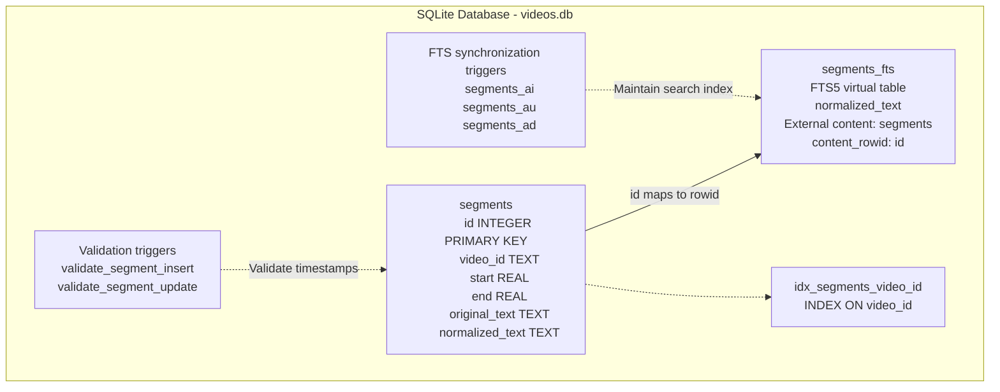
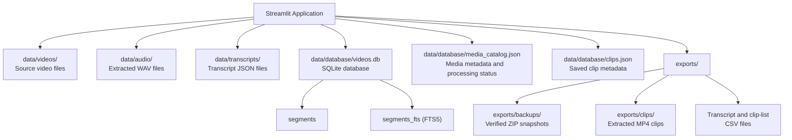

# Arabic Media Archiving, Transcription and Search System

An Arabic-focused application that converts speech in video and standalone audio files into timestamped transcripts, makes transcript content searchable, and allows users to locate relevant moments. Video segments can also be extracted as standalone clips.

**Repository:** [Momen-Abd32/Development-of-an-Arabic-Transcript-Based-Video-Indexing-and-Clip-Search-System](https://github.com/Momen-Abd32/Development-of-an-Arabic-Transcript-Based-Video-Indexing-and-Clip-Search-System)

---

## Table of Contents

- [Project Overview](#project-overview)
- [Features](#features)
- [Technologies](#technologies)
- [System Workflow](#system-workflow)
- [Application Architecture](#application-architecture)
- [Database Schema](#database-schema)
- [Data Storage Architecture](#data-storage-architecture)
- [Project Structure](#project-structure)
- [Requirements](#requirements)
- [Installation](#installation)
- [Running the Application](#running-the-application)
- [Batch Importing a Media Dataset](#batch-importing-a-media-dataset)
- [Running Tests](#running-tests)
- [Evaluation Metrics](#evaluation-metrics)
- [Configuration and Usage Notes](#configuration-and-usage-notes)
- [Known Limitations](#known-limitations)
- [Future Work](#future-work)
- [License](#license)

## Project Overview

Finding a specific moment in a long video or audio recording can be time-consuming, particularly when the content is spoken in Arabic and the user does not know the exact timestamp. This project addresses that problem by turning spoken media content into searchable, timestamped transcript segments.

The application supports individual video and audio uploads, while a batch-import utility can process a local folder of media files. It prepares audio, generates Arabic transcripts, indexes transcript segments, and allows users to search for words or phrases. Video search results can also be exported as separate clips.

The interface supports **Arabic and English**, with Arabic as the default language.

## Features

- **Video upload and preview:** Upload and preview supported video files.
- **Standalone audio upload and playback:** Upload audio recordings without requiring a video container.
- **Audio preparation:** Use FFmpeg to normalize audio from video or standalone audio files to mono 16 kHz WAV for transcription.
- **Batch media import:** Recursively scan a local folder and process supported audio and video files one by one.
- **Watched-folder ingestion:** Poll one or more local folders or mounted NAS shares, wait until new files remain unchanged across consecutive scans, and enqueue only new or changed files for background processing.
- **Remote direct-media URL ingestion:** Download media over HTTPS only from exact operator-allowlisted hosts, validate redirects and public DNS answers, enforce size/time limits, then enqueue the file through the same processing pipeline.
- **S3 cloud object ingestion:** Optionally download media objects from exact operator-allowlisted S3 buckets using boto3 credentials/profiles, enforce object-size and media-type checks, verify downloaded length and SHA-256, and enqueue through the same file-import worker.
- **Durable processing queue:** Persist folder-import jobs in a separate SQLite database, track overall progress, the current file and processing stage, and stage start/completion indicators; retry failures, cancel queued jobs immediately, request cooperative cancellation of active jobs between files, and recover interrupted jobs after restart.
- **Independent background worker:** Run the persistent processing queue as a separate CLI process with polling, worker heartbeats, and expired-lease recovery.
- **Archive dashboard:** Summarize media counts, stored file size, transcript totals, processing and queue states, missing source files, database integrity, and runtime dependency availability.
- **Archive backup and restore:** Create checksummed snapshots of data and exports, use SQLite's online backup API for live databases, verify every file before restore, and restore only into a new directory without overwriting existing data.
- **Optional account authentication and RBAC:** Administrator, editor, and search-only roles; salted PBKDF2 password hashes; account activation and role management; failed-login throttling; and user-attributed note/audit actions.
- **Media catalog:** Persist each media file's type, original filename, stored path, and processing status.
- **Archive collections and tags:** Organize media with optional collection names and deduplicated tags; filter the archive by collection and selected tags. Catalog reads and updates use an OS-level lock around the atomic JSON replacement so concurrent processes on the same host do not silently overwrite each other's metadata changes.
- **Archive-wide search:** Search transcript segments across all imported media or limit the search to the currently selected file.
- **Search filters:** Narrow exact, fuzzy, and hybrid results by media type, source filename, added-date range, collection, tags, and speaker (including segments without a speaker label).
- **Duplicate detection:** Identify identical files using SHA-256 and avoid processing duplicate content within the same batch.
- **Transcript reuse:** Reuse existing transcript JSON files and rebuild their search index instead of transcribing the same media again.
- **Arabic speech recognition:** Generate timestamped transcript segments with Faster-Whisper.
- **Transcript review and editing:** Review generated segments, correct their text, and save the updated transcript. Each segment shows its start/end time and speaker label; its play action opens the source media at that segment's start time. Editing preserves segment metadata such as speaker and confidence.
- **Timestamp-based transcript playback:** Start video or audio preview from a selected transcript segment.
- **Optional speaker diarization:** Attach speaker labels to transcript segments using pyannote.audio when model access is configured; validated timestamp overlap assigns the best-matching speaker, and missing/ambiguous matches or unavailable optional model initialization fall back to `UNKNOWN` without rewriting transcript text.
- **Extractive transcript insights:** Select representative original transcript sentences, rank Arabic/Latin keywords using a term-frequency/document-frequency weighting, normalize Arabic diacritics, Alef variants, and punctuation boundaries for matching without changing the source transcript, and group segments into explainable topic candidates using keyword co-occurrence. Topic candidates retain source timestamps and original segment text; the UI lets reviewers jump from summary/topic source passages back to the corresponding media time. Topic grouping is explicitly heuristic (not semantic topic modeling); insights are stored separately from the verbatim transcript and never rewrite dialect.
- **Video keyframes:** Extract sampled JPEG thumbnails with FFmpeg, preserve the actual frame presentation timestamps, safely replace prior generated frames, and preview them in the transcript workspace.
- **Visual keyframe search:** Index extracted frames in SQLite and search across them using Arabic text descriptions or a reference image with an optional multilingual CLIP model; results include the source media and frame timestamp, with an option to preview the original video at the matched time.
- **Unified cross-modal search:** Combine exact and fuzzy transcript matches with CLIP keyframe matches in one timestamped result list using Reciprocal Rank Fusion (RRF). The system fuses ranks rather than comparing uncalibrated text and image similarity scores; reference-image queries return visually similar frames.
- **Evidence-first archive Q&A:** Ask questions over indexed transcripts, scope retrieval by current media or the entire archive, filter by media type, source name, added-date range, collection, tags, and speaker (including unassigned speakers), retrieve and rank verbatim transcript passages, cite the media ID, segment ID, speaker, and timestamps, and abstain when no evidence is found. Optional semantic retrieval and local Ollama multi-passage answer generation can supplement exact and fuzzy search.
- **Timestamped review notes:** Create, edit, delete, and play back notes attached to a media item and timestamp. Note changes are recorded in the append-only audit history.
- **Arabic text normalization:** Normalize common Arabic character variations, remove diacritics and tatweel, and standardize whitespace to improve search consistency.
- **Exact full-text search:** Find transcript segments using SQLite FTS5.
- **Fuzzy search:** Find approximate matches using RapidFuzz.
- **Optional semantic search:** Search transcript meaning with multilingual sentence embeddings; the optional model is loaded only when requested.
- **Hybrid search:** Fuse FTS5, RapidFuzz, and semantic rankings using Reciprocal Rank Fusion (RRF).
- **Timestamped results:** Display matching transcript text with its position in the source video or audio recording.
- **Clip extraction:** Extract a selected time range from the source video as an MP4 clip.
- **Saved clip management:** Store clip metadata and view saved clips associated with a video.
- **CSV export:** Export transcript segments and saved clip metadata.
- **Human search-evaluation workspace:** Search exact, fuzzy, hybrid, or unified cross-modal results, optionally build the semantic index, inspect source playback and keyframes, mark relevant transcript/frame results, and save reviewed judgments into Git-ignored local datasets used by the metrics CLIs.
- **Transcription evaluation utilities:** Calculate Word Error Rate (WER) and Character Error Rate (CER) against a reference transcript.

### Supported video formats

- MP4
- MKV
- MOV
- AVI
- WEBM

### Supported audio formats

- MP3
- WAV
- M4A
- AAC
- FLAC
- OGG

The Streamlit application upload limit is configured to **2 GB per file**. Actual processing capacity depends on available memory, storage, CPU, and media duration.

## Technologies

| Technology | Role |
|---|---|
| Python 3.12 | Main programming language |
| Streamlit | Web application interface |
| Faster-Whisper | Arabic automatic speech recognition |
| FFmpeg | Audio extraction and video clip processing |
| SQLite | Persistent transcript-segment storage |
| SQLite FTS5 | Full-text transcript search |
| RapidFuzz | Approximate text matching |
| sentence-transformers (optional) | Multilingual semantic and CLIP-compatible visual embeddings |
| Pillow (optional) | Load reference and indexed keyframe images for visual search |
| JiWER | WER and CER evaluation |
| Pytest | Automated testing |

## System Workflow

1. The user uploads an individual video or audio file, or selects a local folder for batch import.
2. The application calculates a SHA-256 media identifier and stores the original source file in the appropriate media directory.
3. FFmpeg prepares a mono 16 kHz WAV file from the video or standalone audio source.
4. Faster-Whisper transcribes the Arabic speech and produces timestamped segments.
5. The transcript is saved as JSON under `data/transcripts/`, and the media catalog records the source filename, type, path, and processing status.
6. Arabic text is normalized and transcript segments are indexed in SQLite.
7. The user can review or edit the transcript for the currently selected media file.
8. The user searches either the selected file or the entire indexed archive using exact, fuzzy, or hybrid search, with optional media, source, date, collection, tag, and speaker filters; the unified search workspace can fuse transcript and visual keyframe rankings or retrieve visually similar frames from a reference image.
9. Search results show the source media, matching text, and timestamps, with a preview of the original file.
10. The user can extract a selected video segment as an MP4 clip.
11. Transcript data and clip metadata can be exported as CSV files.
12. The processing queue persists folder-import jobs and the dashboard summarizes archive and runtime health.

## Application Architecture

The application separates its main responsibilities into modules under `src/`:

| Module | Responsibility |
|---|---|
| `media` | Prepare normalized audio, extract video keyframes, batch-import media folders, manage durable processing jobs, and collect archive/runtime metrics |
| `transcription` | Run speech recognition, validate and manage transcripts, generate optional speaker labels and extractive insights, and export transcript data |
| `indexing` | Normalize Arabic text and index transcript segments |
| `search` | Perform exact, fuzzy, semantic, visual keyframe, and RRF-fused cross-modal retrieval |
| `database` | Create and manage SQLite tables, indexes, and triggers |
| `clips` | Extract video clips, manage clip metadata, and export clip lists |
| `evaluation` | Calculate transcription, transcript retrieval, visual retrieval, and mixed cross-modal ranking metrics |

The Streamlit interface in `app.py` coordinates these modules and presents the workflow to the user.

## Database Schema

The application uses SQLite to store transcript segments and power full-text search. The database is created at:

```text
data/database/videos.db
```

### Main table: `segments`

| Column | Type | Description |
|---|---|---|
| `id` | INTEGER PRIMARY KEY AUTOINCREMENT | Unique segment identifier |
| `video_id` | TEXT | Identifier of the source media file (video or audio) |
| `start` | REAL | Segment start time in seconds |
| `end` | REAL | Segment end time in seconds |
| `original_text` | TEXT | Transcript text |
| `normalized_text` | TEXT | Normalized text used for indexing and search |
| `speaker` | TEXT, nullable | Optional diarization label assigned to the transcript segment |

### Full-text search: `segments_fts`

The `segments_fts` virtual table uses SQLite FTS5 with an external-content configuration linked to `segments`.

- `normalized_text` is the indexed search content.
- `content='segments'` identifies the source table.
- `content_rowid='id'` maps FTS rows to the primary keys in `segments`.

### Indexes and triggers

- `idx_segments_video_id`: Indexes the source media identifier used to filter transcript segments.
- `validate_segment_insert`: Rejects invalid segment timestamps on insertion.
- `validate_segment_update`: Rejects invalid segment timestamps on update.
- `segments_ai`: Adds inserted segment text to the FTS index.
- `segments_au`: Updates the FTS index when a segment changes.
- `segments_ad`: Removes deleted segment text from the FTS index.

### Database schema diagram



**Schema note:** FTS5 is an external-content search index synchronized with the `segments` table through triggers. The current database schema does not define separate SQL tables for videos or clips. Saved clip metadata is stored in a JSON file, as described below.

## Data Storage Architecture

The application uses a combination of local files and SQLite. The main runtime locations are:

The processing queue uses a separate SQLite database so job state can be persisted without modifying transcript or FTS tables. The Streamlit interface can run a queued batch synchronously, and a separate heartbeat-based worker can process jobs continuously.

| Location | Stored data |
|---|---|
| `data/videos/` | Uploaded or batch-imported source video files |
| `data/audio/originals/` | Original standalone audio files |
| `data/incoming/remote/` | Direct media files downloaded from allowlisted HTTPS URLs before processing |
| `data/audio/` | Normalized WAV audio files prepared for transcription |
| `data/transcripts/` | Transcript JSON files |
| `data/insights/` | Optional extractive summaries, keywords, and source-segment references |
| `data/keyframes/` | Generated JPEG keyframes grouped by media identifier |
| `data/database/videos.db` | Transcript segments and the FTS5 search index |
| `data/database/processing_queue.db` | Durable job state, processing stages, watcher signatures, timestamped notes, and audit events |
| `data/database/media_catalog.json` | Media identifiers, original filenames, source paths, types, and processing status |
| `data/database/clips.json` | Metadata for saved video clips |
| `exports/clips/` | Extracted MP4 video clips |
| `exports/` | Transcript and clip-list CSV exports |
| `exports/backups/` | Checksummed ZIP snapshots of archive data and exports |

### Clip metadata

Saved clip metadata is stored in `data/database/clips.json`, independently of the SQLite database.

Each clip record contains:

- `id`: Clip record identifier.
- `video_id`: Identifier of the source video.
- `clip_path`: Path to the extracted clip file.
- `start` and `end`: Clip boundaries in seconds.
- `duration`: Clip duration in seconds.
- `notes`: Text associated with the clip.
- `created_at`: Creation timestamp.

When the same video segment is saved again, its existing metadata is updated rather than creating another logical record. Existing duplicate records for the same video and time range are consolidated.

### Data storage diagram



The application creates runtime directories and files as needed. These generated assets are local application data and are not required to be committed to the source repository.

## Project Structure

```text
Development-of-an-Arabic-Transcript-Based-Video-Indexing-and-Clip-Search-System/
│
├── app.py
├── requirements.txt
├── requirements-cloud.txt  # Optional S3 object-storage adapter
├── README.md
│
├── .streamlit/
│   └── config.toml
│
├── src/
│   ├── clips/
│   │   ├── clip_exporter.py
│   │   ├── clip_manager.py
│   │   └── clip_metadata.py
│   │
│   ├── database/
│   │   └── database_manager.py
│   │
│   ├── evaluation/
│   │   └── metrics.py
│   │
│   ├── indexing/
│   │   ├── indexer.py
│   │   └── text_processor.py
│   │
│   ├── media/
│   │   ├── archive_backup.py
│   │   ├── archive_notes.py
│   │   ├── audio_extractor.py
│   │   ├── archive_metrics.py
│   │   ├── batch_processor.py
│   │   ├── cloud_ingestion.py
│   │   ├── folder_watcher.py
│   │   ├── url_ingestion.py
│   │   ├── keyframe_extractor.py
│   │   ├── media_catalog.py
│   │   ├── processing_queue.py
│   │   └── processing_worker.py
│   │
│   ├── search/
│   │   ├── archive_qa.py
│   │   ├── local_answer_provider.py
│   │   ├── cross_modal_evaluation.py
│   │   ├── cross_modal_evaluation_dataset.py
│   │   ├── cross_modal_search.py
│   │   ├── evaluation.py
│   │   ├── evaluation_dataset.py
│   │   ├── keyframe_search.py
│   │   ├── search_engine.py
│   │   ├── semantic_search.py
│   │   ├── visual_embedding_provider.py
│   │   └── visual_evaluation.py
│   │
│   ├── security/
│   │   └── auth_manager.py
│   └── transcription/
│       ├── faster_whisper_engine.py
│       ├── transcript_exporter.py
│       ├── transcript_insights.py
│       └── transcript_manager.py
│
├── tests/
│   ├── test_archive_metrics.py
│   ├── test_archive_qa.py
│   ├── test_evaluation_dataset.py
│   ├── test_local_answer_provider.py
│   ├── test_auth_manager.py
│   ├── test_cloud_ingestion.py
│   ├── test_cloud_ingestion_cli.py
│   ├── test_archive_backup.py
│   ├── test_archive_backup_cli.py
│   ├── test_archive_notes.py
│   ├── test_folder_watcher.py
│   ├── test_folder_watcher_cli.py
│   ├── test_url_ingestion.py
│   ├── test_url_ingestion_cli.py
│   ├── test_audio_extractor.py
│   ├── test_media_batch_processor.py
│   ├── test_media_catalog.py
│   ├── test_processing_queue.py
│   ├── test_processing_worker.py
│   ├── test_clip_exporter.py
│   ├── test_clip_manager.py
│   ├── test_clip_metadata.py
│   ├── test_database_manager.py
│   ├── test_faster_whisper_engine.py
│   ├── test_indexer.py
│   ├── test_metrics.py
│   ├── test_search_engine.py
│   ├── test_text_processor.py
│   ├── test_keyframe_extractor.py
│   ├── test_keyframe_search.py
│   ├── test_search_evaluation.py
│   ├── test_search_evaluation_cli.py
│   ├── test_visual_embedding_provider.py
│   ├── test_visual_evaluation.py
│   ├── test_visual_search_evaluation_cli.py
│   ├── test_cross_modal_search.py
│   ├── test_cross_modal_evaluation.py
│   ├── test_cross_modal_evaluation_dataset.py
│   ├── test_cross_modal_search_evaluation_cli.py
│   ├── test_transcript_insights.py
│   ├── test_transcript_exporter.py
│   ├── test_transcript_manager.py
│   └── test_speaker_diarizer.py
│
└── scripts/
    ├── evaluate_cross_modal_search.py
    ├── evaluate_visual_search.py
    ├── import_media_dataset.py
    ├── manage_archive_backup.py
    ├── run_processing_worker.py
    ├── import_media_url.py
    ├── import_s3_media.py
    ├── watch_media_folders.py
    └── test_transcription.py
```

## Requirements

- Python 3.12
- FFmpeg available on the system `PATH`
- Git
- pip

Python package versions are pinned in `requirements.txt`.

## Installation

### 1. Clone the repository

```bash
git clone https://github.com/Momen-Abd32/Development-of-an-Arabic-Transcript-Based-Video-Indexing-and-Clip-Search-System.git
cd Development-of-an-Arabic-Transcript-Based-Video-Indexing-and-Clip-Search-System
```

### 2. Create a virtual environment

```bash
python -m venv .venv
```

### 3. Activate the virtual environment

**Windows — Git Bash:**

```bash
source .venv/Scripts/activate
```

**Windows — Command Prompt:**

```bat
.venv\Scripts\activate
```

**Windows — PowerShell:**

```powershell
.\.venv\Scripts\Activate.ps1
```

**Linux / macOS:**

```bash
source .venv/bin/activate
```

### 4. Install Python dependencies

```bash
python -m pip install --upgrade pip
pip install -r requirements.txt
```

### Optional: enable semantic and hybrid search

Semantic search is optional; exact FTS5 and RapidFuzz search continue to work without it. Install the optional model dependency when you want to build a semantic index:

```bash
pip install -r requirements-semantic.txt
```

In the Search tab, choose **Hybrid Semantic Search**, then select **Build / Refresh Semantic Index**. The first use downloads the configured multilingual embedding model. Model download and embedding generation require additional disk space, memory, and processing time.

#### Optional: enable SQLite vector retrieval

For a SQLite-native KNN execution path, install the separately pinned optional extension:

```bash
pip install -r requirements-vector.txt
```

The semantic search index will create and rebuild its derived `vec0` table automatically when needed. Existing JSON embeddings remain the source of truth, and the exact Python/SQLite heap implementation remains the fallback if the extension is unavailable or a query uses unsupported multi-media or speaker filters. The vector table is derived and can be recreated without changing the stored transcript or embedding format.

This backend is an optional native KNN path, **not an approximate HNSW/ANN index**; do not interpret it as eliminating linear-scan behavior or as a measured latency improvement until benchmarked on representative archive sizes.

A reproducible synthetic benchmark compares steady-state SQLite KNN latency with the exact heap fallback and checks top-k ID agreement (it excludes one-time vector-table construction):

```bash
python scripts/benchmark_semantic_search.py --segments 10000 --dimension 64 --queries 10 --top-k 10
```

The benchmark uses deterministic generated vectors and does not download models or claim real Dukkan Media relevance quality. Run it at several archive sizes and retain the JSON output when collecting performance evidence.

### Optional: enable visual keyframe search

Visual search requires extracted video keyframes and two aligned optional CLIP encoders: the original image encoder and a multilingual text encoder that supports 50+ languages, including Arabic. The provider deliberately uses the image model for frames and the multilingual model for text queries:

```bash
pip install -r requirements-visual.txt
```

Open the **Visual Search** tab and choose **Build / Refresh Visual Keyframe Index**. The first run downloads both CLIP checkpoints, automatically extracts keyframes from videos that do not yet have them, and indexes the frames. You can then search with an Arabic scene description or upload a reference image. Results show the matched frame, source video, and its FFmpeg presentation timestamp; use the preview action to open the original video at that time. A video whose original file is missing can still be searched if its keyframe images and timestamp metadata were indexed previously.

Visual embeddings are stored separately in SQLite. Exact transcript search and other archive workflows do not require the visual dependencies. The checked-in tests use a deterministic fake provider and do not download or validate the real model against Dukkan Media content.

To evaluate visual retrieval, copy `data/evaluation/visual_queries.example.json` to `data/evaluation/visual_queries.json`, replace the placeholder media IDs/frame indices with human-reviewed judgments, and ensure the visual index is built. The dataset supports both Arabic text-to-image queries and reference-image-to-image queries:

```bash
python scripts/evaluate_visual_search.py --dataset data/evaluation/visual_queries.json --top-k 5
```

The report includes macro Precision@k, Recall@k, and MRR. The checked-in dataset is only a template; it is not a benchmark and must not be used to claim real archive accuracy.

To evaluate the **combined transcript + visual ranking**, use the Search Evaluation workspace's unified cross-modal mode to create `data/evaluation/cross_modal_queries.json`, or copy `data/evaluation/cross_modal_queries.example.json` and replace the placeholder media IDs, transcript timestamps, and frame indices with human-reviewed relevance judgments. The workspace currently labels text-to-transcript/keyframe results; reference-image-to-image judgments remain available through the visual template:

```bash
python scripts/evaluate_cross_modal_search.py --dataset data/evaluation/cross_modal_queries.json --top-k 5
```

This evaluator measures the fused RRF result list with macro Precision@k, Recall@k, and MRR. It requires the optional visual dependencies and a built keyframe index. The example judgments are placeholders, not measured performance.


### Optional: enable speaker diarization

Speaker diarization requires the optional dependencies, a Hugging Face access token, and acceptance/access to the selected pyannote model:

```bash
pip install -r requirements-diarization.txt
```

Set `HF_TOKEN` in your environment, then use **Identify Speakers** in the Transcript tab. Speaker labels are metadata attached to transcript segments using greatest temporal overlap; segments with no overlapping diarization turn are labeled `UNKNOWN`. If the optional model cannot initialize because its package/token is unavailable, the UI marks segments `UNKNOWN` and allows transcript review to continue. Timestamp values and turn labels are validated before annotation, and the original recognized words are not rewritten.

### 6. Install and verify FFmpeg

Install FFmpeg using the instructions for your operating system, then ensure that the FFmpeg executable is available through the system `PATH`.

Verify the installation:

```bash
ffmpeg -version
```

## Running the Application

From the repository root, with the virtual environment activated, run:

```bash
streamlit run app.py
```

Streamlit prints a local URL in the terminal. The default address is usually:

```text
http://localhost:8501
```

On the first transcription run, Faster-Whisper may need to download its model files. An internet connection is therefore required for the initial model download unless the model is already available locally.

## Batch Importing a Media Dataset

Place the media files in a local folder, external drive, or a directory that is accessible to the machine running the application. The importer scans subdirectories by default and supports the video and audio formats listed above.

Run the importer from the repository root:

```bash
python scripts/import_media_dataset.py --input-dir "path/to/media-folder"
```

On Windows, for example:

```powershell
python scripts/import_media_dataset.py --input-dir "D:\DukkanMedia\Incoming"
```

Optional arguments:

- `--non-recursive`: Process only files directly inside the selected folder.
- `--model-size`: Select a Faster-Whisper model; defaults to `tiny`.
- `--device`: Select `cpu` or `cuda`; defaults to `cpu`.
- `--compute-type`: Set the CTranslate2 compute type; defaults to `int8`.

The importer stores source videos in `data/videos/`, original audio files in `data/audio/originals/`, normalized WAV files in `data/audio/`, and transcript JSON files in `data/transcripts/`. Transcript segments are indexed in the existing SQLite database.

Each file is processed independently. A failure for one file is reported without stopping the rest of the batch. Identical content is processed once per batch, and an existing valid transcript is reused and re-indexed. The first new file that requires transcription initializes the Whisper model, which is then reused for the remaining files in that run.

A USB drive or network share can be used by passing its mounted folder path. Continuous polling-based folder watching is available for local and mounted folders. Direct cloud-provider APIs and authenticated streaming-platform/playlist downloads are not implemented yet; URL ingestion supports direct media files from explicitly allowlisted HTTPS hosts.

## Watched Folder Ingestion

To monitor one or more incoming folders continuously, start the watcher in a separate terminal:

```bash
python scripts/watch_media_folders.py --folder "D:\DukkanMedia\Incoming"
```

Multiple folders can be supplied by repeating `--folder`. Useful options include `--poll-seconds 10`, `--stable-scans 3`, and `--non-recursive`. A file is queued only after its size and modification timestamp remain unchanged for the configured number of consecutive scans. The watcher persists file signatures in the processing queue database and creates explicit file-import jobs, so new files do not require rescanning and re-indexing the entire folder.

Run the watcher and the background worker in separate processes. The watcher only discovers stable files and enqueues work; the worker performs the normal SHA-256 validation, audio preparation, transcription, and indexing pipeline. If a file changes after being queued, the next stable scan detects its new signature and queues it again.

## Remote Direct-Media URL Ingestion

For a direct downloadable audio/video file, explicitly allowlist the exact host and enqueue the downloaded file:

```bash
python scripts/import_media_url.py \
  --url "https://media.example.com/archive/interview.mp4" \
  --allowed-host media.example.com
```

Repeat `--url` for multiple files and `--allowed-host` for each trusted host. The adapter accepts HTTPS on port 443 only, rejects embedded credentials and non-allowlisted hosts, manually validates every redirect, rejects DNS answers that are not globally routable, disables environment proxies, checks media content types, and enforces a configurable download-size limit (`--max-bytes`) and timeout (`--timeout-seconds`). Downloaded files are stored under `data/incoming/remote/` and queued as explicit file-import jobs; run the background worker separately to transcribe and index them.

Only allowlist domains controlled by the archive operator. DNS addresses are checked before each request but are not pinned at the socket layer, so use a trusted host allowlist and network egress controls for deployments exposed to untrusted users. This adapter downloads direct media files only; it does not scrape YouTube or authenticated streaming pages, playlists, or links that require browser cookies or custom authorization headers.

## S3 Cloud Object Ingestion

S3-compatible object storage is supported through an optional adapter. Install its dependencies separately so the core local archive does not require a cloud SDK:

```bash
pip install -r requirements-cloud.txt
```

Configure AWS credentials using the standard boto3 environment, shared credentials file, IAM role, or an explicitly selected profile. Then allowlist the exact bucket names and enqueue one or more objects:

```bash
python scripts/import_s3_media.py \
  --bucket dukkan-archive \
  --key "recordings/interview.mp4" \
  --allowed-bucket dukkan-archive \
  --region eu-central-1
```

Repeat `--bucket` and `--key` together for additional objects, and repeat `--allowed-bucket` for every trusted bucket. The CLI downloads each object to `data/incoming/cloud/`, checks the declared size and supported media type, verifies the complete byte count, calculates SHA-256, and queues a normal `file_import` job. The background worker then uses the same deduplication, transcription, catalog, and indexing pipeline as local and watched-folder imports.

For an operator-managed S3-compatible service, `--endpoint-url` may be supplied explicitly. Treat that endpoint as trusted deployment configuration; never accept it from an untrusted user. Bucket allowlisting is exact, and the application does not store cloud credentials in the archive or Git repository. The adapter does not enumerate buckets, sync remote deletions, or implement provider-specific Google Drive/Azure integrations.

## Background Processing Worker

The Streamlit queue tab can enqueue folder-import jobs and run one job on demand. For continuous processing independent of the browser session, start the worker in a separate terminal:

```bash
python scripts/run_processing_worker.py
```

Useful options:

```bash
python scripts/run_processing_worker.py --once
python scripts/run_processing_worker.py --poll-seconds 10 --lease-seconds 900
```

The worker claims jobs transactionally, reports per-file progress, retries failed batches according to each job's attempt limit, and renews its lease while working. Queued jobs can be cancelled immediately. Running jobs accept a cancellation request and stop at the next per-file progress callback, allowing the current file to finish safely. The cancellation request is persisted so a restarted worker can complete recovery.

## Audit History

The application stores an append-only audit trail in `data/database/processing_queue.db`. SQLite triggers reject ordinary `UPDATE` and `DELETE` statements against existing audit events, and the triggers are added when opening older databases. It records media registration and metadata/status changes, timestamped note creation/updates/deletions, plus processing-job enqueue, start, retry scheduling, failure, cancellation, manual retry, and completion events. Each event includes a UTC timestamp, actor (defaults to `system` until authentication is introduced), entity identity, and JSON before/after details where applicable.

Use the `AuditLog` service to query recent events or filter by entity type, entity ID, and actor. The audit history is local to this application instance. Database-level triggers prevent routine mutation, but a privileged database operator can still alter the schema or file; this is not a tamper-proof compliance log or a substitute for authenticated user identity.

## Authentication and Role-Based Access

Authentication is optional and disabled by default to preserve the single-user local workflow. To enable it, configure an initial administrator before starting Streamlit. In Windows PowerShell:

```powershell
$env:ARCHIVE_AUTH_ENABLED = "true"
$env:ARCHIVE_ADMIN_USERNAME = "archive-admin"
$env:ARCHIVE_ADMIN_PASSWORD = "use-a-unique-password-of-at-least-12-characters"
$env:ARCHIVE_ADMIN_DISPLAY_NAME = "Archive Administrator"
python -m streamlit run app.py
```

On first startup, the app creates the initial administrator only if the user table is empty. Bootstrap uses a SQLite write transaction, so concurrent application starts cannot both claim to create the first administrator. Role changes and account activation also protect the last active administrator atomically across concurrent admin sessions. There is no built-in default account or password. Keep these environment variables out of source control and rotate/remove the bootstrap password after the account is created.

| Role | Access |
|---|---|
| Administrator | All archive features and user/role administration |
| Editor | Upload, transcription, search, notes, clips, archive management, processing queue, dashboard, and audit history |
| Search only | Transcript/visual/cross-modal search, evidence-based archive Q&A, and dashboard |

Passwords are stored as PBKDF2-HMAC-SHA256 hashes with per-user random salts (600,000 iterations by default). Passwords must be at least 12 characters. Five failed attempts within the configured 15-minute window trigger temporary account lockout. User creation, role changes, activation/deactivation, and password resets are written to the append-only audit log. Notes use the authenticated account as author/editor when authentication is enabled.

This is application-level local RBAC, not a full identity provider: there is no SSO or MFA, and login throttling is account-based rather than IP-based. For shared or network-accessible deployments, use HTTPS, restrict network access, protect environment secrets, and add an appropriate reverse proxy/security boundary. Do not expose the development Streamlit server directly to the public internet.

## Archive Backup and Restore

Create a backup from the repository root:

```bash
python scripts/manage_archive_backup.py create --output exports/backups/archive-snapshot.zip
```

Verify the manifest and SHA-256 checksums before relying on a backup:

```bash
python scripts/manage_archive_backup.py verify --backup exports/backups/archive-snapshot.zip
```

Restore into a **new directory that does not already exist**:

```bash
python scripts/manage_archive_backup.py restore --backup exports/backups/archive-snapshot.zip --target ../archive-restore
```

Backups include files under `data/` and `exports/`. SQLite database files are captured through SQLite's online backup API so committed WAL data is included consistently. Temporary files, SQLite WAL/SHM sidecars, symlinks, and previous backups under `exports/backups/` are excluded. The manifest records each included file's size and SHA-256 digest; verification rejects path traversal, missing files, unexpected entries, and checksum mismatches.

Restore does not overwrite the live application directory. After checking the restored contents, stop the app and background workers before copying the restored `data/` and `exports/` directories into the application root. Source code, environment variables, secrets, and model caches are not included.

## Running Tests

Run the complete automated test suite from the repository root:

```bash
python -m pytest tests
```

For more detailed output:

```bash
python -m pytest tests -v
```

The complete test suite should be run after pulling the current development branch. Automated tests cover concurrent catalog writes, immutable audit-event enforcement, atomic administrator bootstrap and last-admin protection, S3 object-ingestion validation and queue handoff, as well as Arabic token normalization and weighted insight ranking, source-linked topic extraction, malformed timestamp rejection, diarization adapter behavior, speaker-overlap assignment, and UNKNOWN fallback. They do not by themselves establish real-world transcription accuracy or replace end-to-end testing with varied video and audio inputs.

## Timestamped Review Notes

The **Review Notes** workspace stores comments against a media SHA-256 ID and a non-negative timestamp. Notes can be created, listed in timestamp order, edited, deleted, and played back from their source position. The notes table is additive in the existing processing/audit SQLite database; it does not change transcript, media catalog, or clip metadata formats.

Each create/update/delete action appends an audit event. When optional authentication is enabled, the author/editor is taken from the authenticated account; when authentication is disabled, it remains a user-entered label. The application is still designed as a local single-instance archive, so notes are not synchronized across multiple live application instances.

## Evidence-First Archive Q&A

The Streamlit application includes an **Ask the Archive** workspace. It searches indexed transcript segments using SQLite FTS5 exact retrieval and RapidFuzz fuzzy retrieval, then fuses the ranked lists with Reciprocal Rank Fusion (RRF). Optional multilingual semantic retrieval can be enabled when the semantic package is installed and the selected archive has a built semantic index.

In the default mode, the answer is deliberately **extractive**: it quotes the highest-ranked original transcript segment verbatim and attaches a citation containing the media ID, segment ID, and start/end timestamps. Additional ranked passages are shown as evidence, with source playback links when the original media file is available. Questions can be scoped to the current media or entire archive and filtered by media type, source name, added-date range, collection, and tags. If no transcript evidence is retrieved, the system abstains instead of inventing an answer.

The default mode is extractive and requires no local language model. For optional multi-passage answer generation, install and start [Ollama](https://ollama.com), then pull a local model such as:

```bash
ollama pull qwen2.5:3b
```

Enable **Generate a multi-passage answer with local Ollama** in the Q&A workspace and enter the installed model name if it differs. The adapter connects only to the loopback Ollama service at `127.0.0.1:11434`; it does not send transcript evidence to a remote model endpoint. Every generated claim must cite media and segment IDs present in the retrieved evidence, otherwise the UI falls back to the verbatim extractive quote. This validates citation membership, not logical entailment: users must still review the cited context. Visual-only question answering is not implemented.

## Search Retrieval Evaluation

The project includes macro-averaged Precision@k, Recall@k, and Mean Reciprocal Rank (MRR) for comparing exact, fuzzy, standalone semantic, and hybrid transcript retrieval against human relevance judgments.

Use the **Search Evaluation** workspace in the Streamlit app to enter a query and choose exact, fuzzy, semantic-only, hybrid, or unified cross-modal retrieval. Semantic-only and hybrid modes can build the semantic index; cross-modal mode requires the optional visual dependencies and a built keyframe index. Mark relevant transcript passages and/or keyframes, inspect source playback, and save judgments. Transcript labels are written atomically to `data/evaluation/search_queries.json`; mixed transcript/keyframe labels are written to `data/evaluation/cross_modal_queries.json`. Both files are ignored by Git because they contain references to the local archive. Alternatively, create either file manually from its checked-in template and replace example IDs/timestamps/frame indices with human-reviewed results. Include varied Arabic queries: MSA wording, spelling variants, diacritics, and mixed Arabic/English phrases.

Run one retrieval mode, or use `all` to compare every transcript ranker against the exact same relevance judgments in a single report:

```bash
python scripts/evaluate_search.py --mode exact --dataset data/evaluation/search_queries.json --top-k 5
python scripts/evaluate_search.py --mode fuzzy --dataset data/evaluation/search_queries.json --top-k 5
python scripts/evaluate_search.py --mode semantic --dataset data/evaluation/search_queries.json --top-k 5
python scripts/evaluate_search.py --mode hybrid --dataset data/evaluation/search_queries.json --top-k 5
python scripts/evaluate_search.py --mode all --dataset data/evaluation/search_queries.json --top-k 5 --build-semantic-index --output reports/retrieval-comparison.json
```

Standalone semantic and hybrid evaluation require the optional semantic dependencies and an existing semantic index. Add `--build-semantic-index` to build/refresh embeddings before either evaluation mode. The `semantic` mode measures vector retrieval by itself; `hybrid` measures the fused lexical, fuzzy, and semantic ranking. Use `--output reports/semantic-evaluation.json` or `--output reports/hybrid-evaluation.json` to save individual reports. The `all` mode emits a `results` object containing all four metric summaries, making side-by-side comparison reproducible. Semantic and hybrid modes require the optional semantic dependencies and an existing semantic index; `--build-semantic-index` builds/refreshes it before evaluation.

Before any search runs, the evaluator validates every human-labeled segment: it must include a non-empty media ID (media_id or video_id), finite numeric timestamps, and a valid non-negative interval where 0 <= start < end. Invalid labels are rejected with the query and segment index so malformed judgments do not silently distort the metrics.

The checked-in file is a template, not a measured benchmark. Do not report its results as real archive performance until the relevance judgments have been reviewed and populated using representative Dukkan Media content.

## Evaluation Metrics

The `src/evaluation/metrics.py` module provides two metrics for comparing a generated transcript with a reference transcript. Both inputs are normalized using the project's Arabic text processor before calculation.

### Word Error Rate (WER)

WER measures transcription differences at the word level, based on substitutions, deletions, and insertions relative to the reference.

### Character Error Rate (CER)

CER measures transcription differences at the character level.

These metrics are evaluation utilities; they do not represent a claimed accuracy score for the application. A meaningful score requires a suitable reference transcript and test dataset.

## Configuration and Usage Notes

### Upload size

The Streamlit upload limit is configured in `.streamlit/config.toml`:

```toml
[server]
maxUploadSize = 2048
```

The application also checks the uploaded file size and supported extension.

### Transcription model

The current application initializes Faster-Whisper with the `tiny` model. The engine defaults to CPU execution with `int8` computation. Transcription is configured for Arabic speech.

### Persistent files and application session

Uploaded videos, original audio files, normalized audio, transcript JSON files, the SQLite database, media catalog, clip metadata, and exported clips are written to local storage. The active media selection and interface state still use Streamlit session state and are not automatically restored after an application restart. When a previously imported file is selected again, the application can reload its saved transcript and rebuild its search index without repeating speech recognition.

## Known Limitations

- Transcription quality depends on audio clarity, accents, background noise, and the selected speech-recognition model.
- The default `tiny` model favors lower resource usage; it may not provide the highest transcription accuracy.
- Fuzzy search compares transcript segments and can require more processing as the indexed transcript collection grows.
- Semantic and hybrid transcript search are optional and require installing `requirements-semantic.txt` and explicitly building the semantic index. An additional optional `sqlite-vec` backend can execute KNN retrieval inside SQLite; the JSON embedding table remains authoritative and the existing exact heap implementation remains the fallback. Visual keyframe search separately requires `requirements-visual.txt`, extracted keyframes, and a built visual index.
- Speaker diarization is optional, requires a Hugging Face token and access to the gated pyannote model, and has not yet been evaluated on Dukkan Media recordings.
- The optional `sqlite-vec` backend currently provides SQLite-native KNN execution for unfiltered or single-media semantic queries; multi-media and speaker-filtered queries retain the exact heap fallback. It is not an approximate HNSW/ANN index, so large-archive latency and scaling gains are not yet established. A true ANN backend and retrieval-performance/recall benchmarks remain future work.
- Archive Q&A defaults to a verbatim transcript quote and can optionally use a local Ollama model to generate multi-passage claims with references to retrieved segments. Citation IDs are checked against retrieved evidence, but this does not prove logical entailment; visual-only question answering is not implemented.
- Visual search uses multilingual CLIP embeddings, but its retrieval quality has not yet been measured against a human-judged Dukkan Media visual-search dataset. Keyframes are sampled every 30 seconds and capped at 300 frames per video by default, so very long recordings may need a configurable sampling policy to cover their full duration. Frame timestamps are sampled from FFmpeg presentation timestamps.
- The application currently uses local file storage and a local SQLite database; it is not designed as a multi-user hosted service.
- Timestamped notes provide a local review workflow with audit events. Author/editor values are authenticated when optional account authentication is enabled and are user-entered labels otherwise; simultaneous multi-instance collaboration is not implemented.
- Batch import reads local or mounted folders. The polling watcher supports continuous monitoring of local/mounted folders, direct-media URL ingestion supports HTTPS files from explicitly allowlisted hosts, and optional S3 ingestion supports exact allowlisted buckets. Provider-specific Google Drive/Azure integrations, remote deletion synchronization, authenticated streaming pages, and playlist downloads are not implemented.
- The SQLite segment table retains the legacy `video_id` column name; for audio records, it stores the SHA-256 media identifier as well.
- The media catalog remains a backward-compatible local JSON file. An OS-level advisory lock serializes catalog reads and updates between processes on the same host; this is not distributed locking for multiple hosts sharing an unreliable network filesystem, nor does it provide live multi-instance UI synchronization.
- Active application session state is not automatically reconstructed after a process restart.
- WER and CER require reference transcripts and are not standalone measures of application quality.

## Product Expansion Roadmap

See [`docs/IMPLEMENTATION_ROADMAP.md`](docs/IMPLEMENTATION_ROADMAP.md) for the full four-phase plan covering hybrid Arabic search, speaker diarization, summaries and topics, synchronized transcript playback, thumbnails/keyframes, collections and tags, resilient processing queues, dashboards, audit history, role-based access, modular ingestion adapters, visual search, evidence-grounded archive Q&A, and timestamped collaboration notes.

## License

No open-source license has been specified for this repository. All rights remain with the respective copyright holder unless a license is added.
