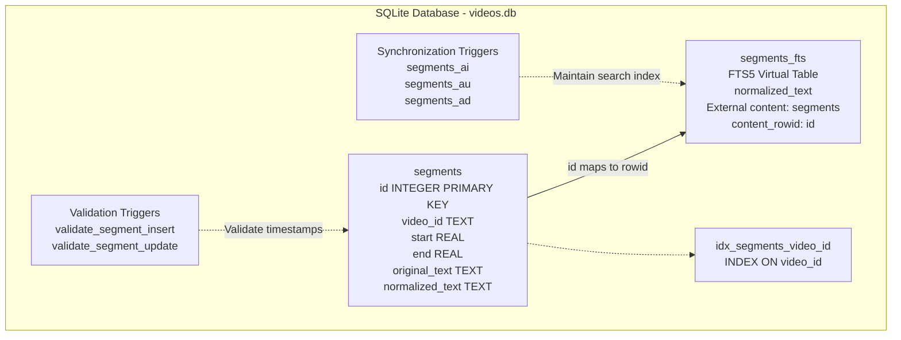
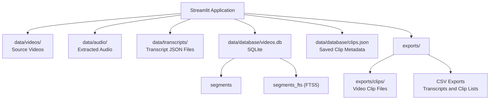

# Arabic Transcript-Based Video Indexing and Clip Search System

An Arabic-focused video indexing and clip search system that transforms spoken content in videos into searchable, timestamped transcripts. The system allows users to search within video content, locate relevant moments, and save selected video segments as independent clips.

**GitHub Repository:** [Development of an Arabic Transcript-Based Video Indexing and Clip Search System](https://github.com/Momen-Abd32/Development-of-an-Arabic-Transcript-Based-Video-Indexing-and-Clip-Search-System)

---

## 1. Project Overview

This project aims to make video content easier to explore by converting speech into timestamped text and providing search capabilities over the generated transcripts.

The system is primarily designed for Arabic speech. It uses automatic speech recognition to generate transcripts, processes and normalizes Arabic text, and indexes transcript segments to support efficient searching.

Users can search for words or phrases, identify their corresponding timestamps, navigate to relevant moments in the video, and export selected portions as separate clips.

## 2. Key Features

- **Video Upload:** Upload video files for processing.
- **Audio Extraction:** Extract audio from video files using FFmpeg.
- **Speech-to-Text:** Generate timestamped transcripts using Faster-Whisper.
- **Arabic Text Processing:** Normalize Arabic text to improve search consistency.
- **Transcript Management:** View, manage, and edit transcript segments.
- **Full-Text Search:** Search transcript content using SQLite FTS5.
- **Fuzzy Search:** Support approximate text matching using RapidFuzz.
- **Timestamp Navigation:** Locate relevant moments in the original video.
- **Clip Management:** Select and save video segments with their timestamps and notes.
- **Transcript Export:** Export transcript data to CSV.
- **Clip Export:** Export selected video segments as separate video files.
- **Evaluation:** Calculate Word Error Rate (WER) and Character Error Rate (CER).

## 3. Technologies Used

| Technology | Purpose |
|---|---|
| Python | Main programming language |
| Streamlit | Interactive application interface |
| Faster-Whisper | Automatic speech recognition |
| FFmpeg | Audio extraction and video processing |
| SQLite | Structured data storage |
| SQLite FTS5 | Full-text search |
| RapidFuzz | Approximate text matching |
| JiWER | Speech recognition evaluation |
| Pytest | Automated testing |

## 4. System Workflow

The system follows these main processing stages:

1. The user uploads a video.
2. The application extracts its audio.
3. Faster-Whisper processes the audio and generates timestamped transcript segments.
4. Arabic text is normalized to improve consistency.
5. Transcript segments are stored and indexed in SQLite.
6. The user searches for words or phrases.
7. The search engine retrieves matching transcript segments.
8. The user navigates to the corresponding video timestamps.
9. Selected portions can be saved and exported as separate clips.

## 5. System Architecture

The application is organized into separate modules, each responsible for a specific part of the processing pipeline.

- **Media:** Handles audio extraction.
- **Transcription:** Handles speech recognition and transcript management.
- **Indexing:** Processes and indexes transcript text.
- **Search:** Retrieves matching transcript segments.
- **Database:** Manages structured storage and full-text search.
- **Clips:** Handles clip metadata and video segment export.
- **Evaluation:** Calculates transcription quality metrics.

## 6. Database Schema

The system uses SQLite for transcript segment storage and full-text search.

### Main Table: `segments`

| Column | Type | Description |
|---|---|---|
| id | INTEGER | Primary key |
| video_id | TEXT | Identifier of the source video |
| start | REAL | Segment start time in seconds |
| end | REAL | Segment end time in seconds |
| original_text | TEXT | Original transcript text |
| normalized_text | TEXT | Normalized transcript text |

### Full-Text Search: `segments_fts`

The `segments_fts` virtual table uses SQLite FTS5 with an external-content configuration referencing the `segments` table.

- `normalized_text` is indexed for full-text searching.
- `content='segments'` identifies the source table.
- `content_rowid='id'` maps the FTS row identifier to the primary key of the source table.

### Indexes and Triggers

- `idx_segments_video_id`: Index on `video_id`.
- `validate_segment_insert`: Validates timestamps before insertion.
- `validate_segment_update`: Validates timestamps before updates.
- `segments_ai`: Synchronizes inserted segments with the full-text index.
- `segments_au`: Synchronizes updated segments with the full-text index.
- `segments_ad`: Synchronizes deleted segments with the full-text index.

### Database Schema Diagram



**Note:** The FTS5 virtual table is not a separate application entity or a conventional relational table. It is an external-content search index synchronized with `segments` through triggers. The current schema does not define a separate `videos` or `clips` SQL table.

## 7. Data Storage Architecture

The application uses both SQLite and file-based storage.

| Storage Location | Purpose |
|---|---|
| `data/videos/` | Uploaded source videos |
| `data/audio/` | Extracted audio files |
| `data/transcripts/` | Stored transcript data |
| `data/database/videos.db` | Transcript segments and full-text search index |
| `data/database/clips.json` | Metadata of saved clips |
| `exports/clips/` | Exported video clips |
| `exports/` | Exported transcript and clip-list CSV files |

### Clip Metadata

Saved clip information is maintained separately in `clips.json`, rather than in a SQL table.

Each saved clip contains:

- `id`
- `video_id`
- `clip_path`
- `start`
- `end`
- `duration`
- `notes`
- `created_at`

The metadata manager validates clip information and writes updates through a temporary file before replacing the metadata file.

### Data Storage Diagram



## 8. Project Structure

```text
Development-of-an-Arabic-Transcript-Based-Video-Indexing-and-Clip-Search-System/
│
├── app.py
├── requirements.txt
├── README.md
│
├── src/
│   ├── clips/
│   │   ├── clip_exporter.py
│   │   ├── clip_manager.py
│   │   └── clip_metadata.py
│   │
│   ├── database/
│   │   └── database_manager.py
│   │
│   ├── evaluation/
│   │   └── metrics.py
│   │
│   ├── indexing/
│   │   ├── indexer.py
│   │   └── text_processor.py
│   │
│   ├── media/
│   │   └── audio_extractor.py
│   │
│   ├── search/
│   │   └── search_engine.py
│   │
│   └── transcription/
│       ├── faster_whisper_engine.py
│       ├── transcript_exporter.py
│       └── transcript_manager.py
│
├── tests/
│   ├── test_audio_extractor.py
│   ├── test_clip_exporter.py
│   ├── test_clip_manager.py
│   ├── test_clip_metadata.py
│   ├── test_database_manager.py
│   ├── test_faster_whisper_engine.py
│   ├── test_indexer.py
│   ├── test_metrics.py
│   ├── test_search_engine.py
│   ├── test_text_processor.py
│   ├── test_transcript_exporter.py
│   └── test_transcript_manager.py
│
├── scripts/
│   └── test_transcription.py
│
├── data/
│   ├── videos/
│   ├── audio/
│   ├── transcripts/
│   └── database/
│
├── exports/
│   └── clips/
│
└── .streamlit/
    └── config.toml
```

Runtime-generated files and local test artifacts are not listed individually.

## 9. Requirements

- Python 3.12
- FFmpeg
- pip
- Git

The Python dependencies are listed in `requirements.txt`.

## 10. Installation and Setup

### 1. Clone the repository

```bash
git clone https://github.com/Momen-Abd32/Development-of-an-Arabic-Transcript-Based-Video-Indexing-and-Clip-Search-System.git
```

```bash
cd Development-of-an-Arabic-Transcript-Based-Video-Indexing-and-Clip-Search-System
```

### 2. Create a virtual environment

```bash
python -m venv .venv
```

### 3. Activate the virtual environment

Windows Git Bash:

```bash
source .venv/Scripts/activate
```

Windows Command Prompt:

```bash
.venv\Scripts\activate
```

### 4. Install dependencies

```bash
pip install -r requirements.txt
```

### 5. Install FFmpeg

Install FFmpeg separately and ensure that it is available through the system PATH.

Verify the installation:

```bash
ffmpeg -version
```

## 11. Running the Application

Start the Streamlit application:

```bash
streamlit run app.py
```

The application will be available through the local URL displayed in the terminal, usually:

```text
http://localhost:8501
```

## 12. Running Tests

Run the complete automated test suite:

```bash
pytest
```

For verbose output:

```bash
pytest -v
```

### Current Test Results

The project test suite was executed successfully.

**127 tests passed.**

These results represent the automated tests included in the repository. They do not independently establish real-world transcription accuracy or replace end-to-end testing with different video and audio inputs.

## 13. Evaluation Metrics

The project includes two standard metrics for evaluating speech recognition output.

### Word Error Rate (WER)

WER measures the difference between the reference transcript and the generated transcript at the word level.

### Character Error Rate (CER)

CER measures the difference between the reference transcript and the generated transcript at the character level.

Both metrics help assess transcription quality and identify recognition errors.

## 14. Configuration

The Streamlit configuration is stored in:

```text
.streamlit/config.toml
```

The current server upload limit is configured as:

```toml
[server]
maxUploadSize = 2048
```

This configures the application upload limit to 2048 MB. Actual processing capacity also depends on available system memory, storage, and hardware resources.

## 15. Future Improvements

Potential future enhancements include:

- Improving Arabic speech recognition accuracy.
- Supporting additional languages.
- Enhancing search ranking and relevance.
- Improving processing performance for long videos.
- Adding more advanced transcript evaluation and analysis.
- Improving clip organization and metadata management.

## 16. License

No license has currently been specified for this repository.